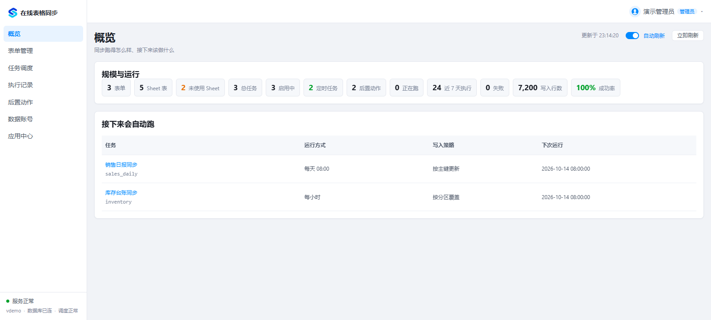
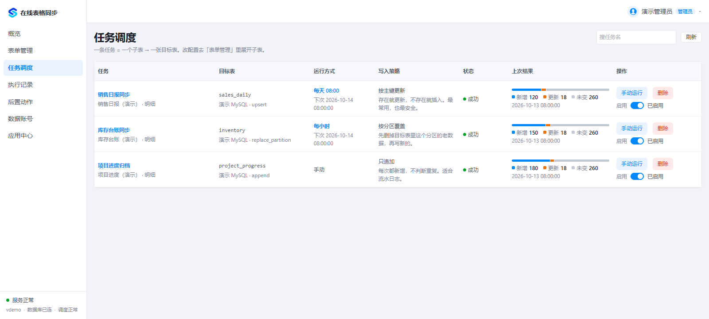
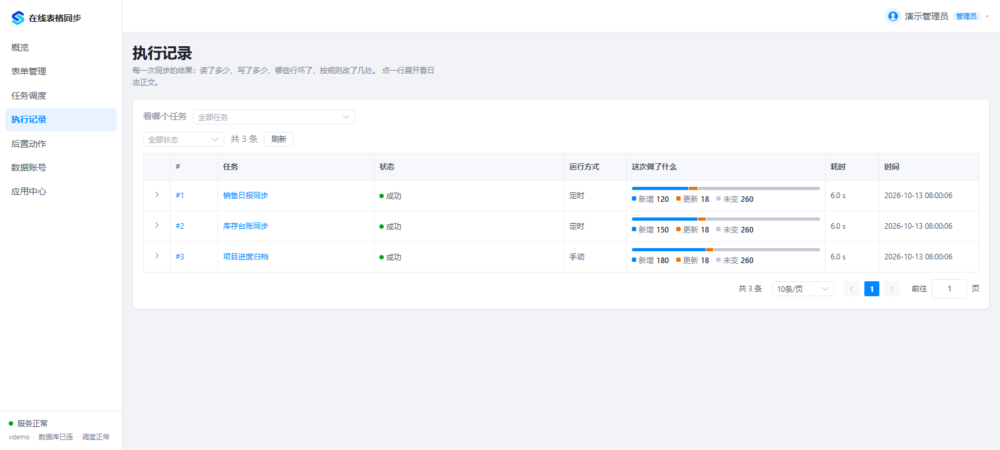
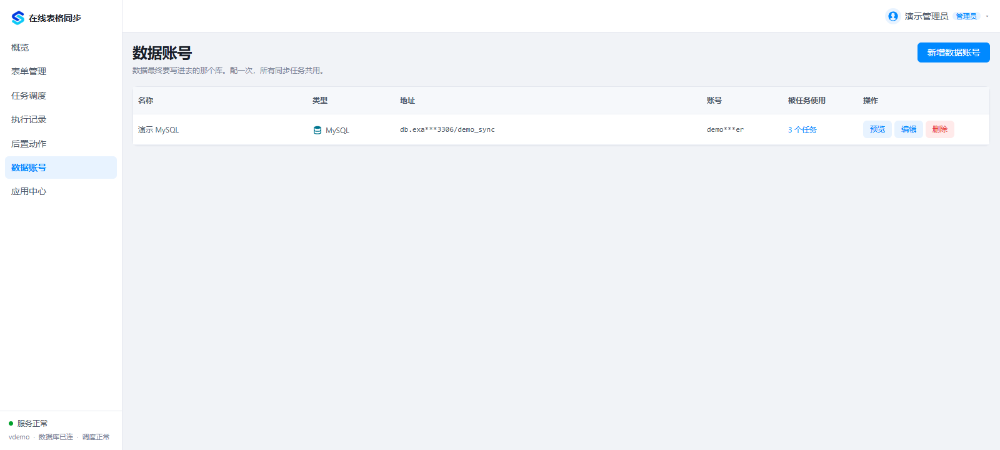
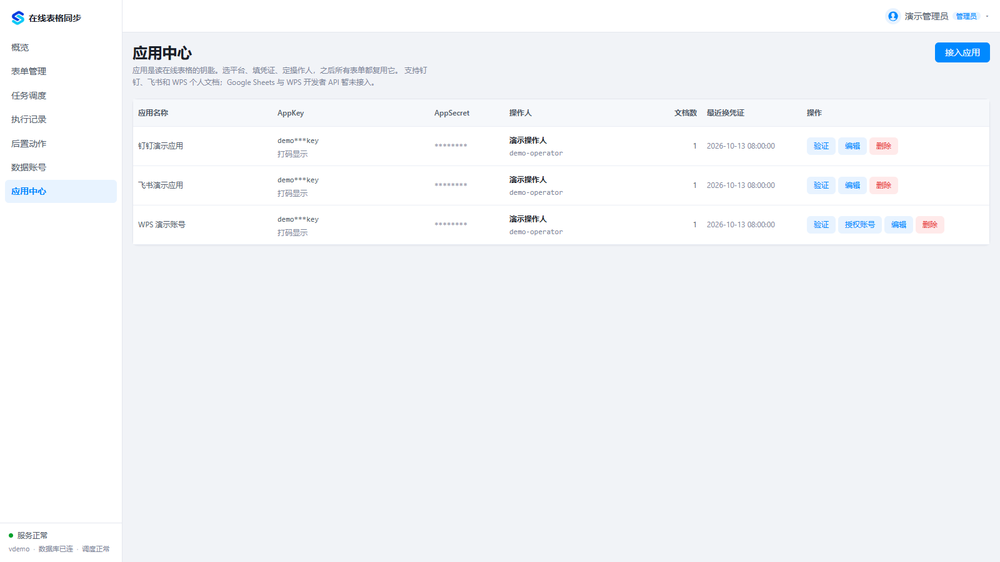
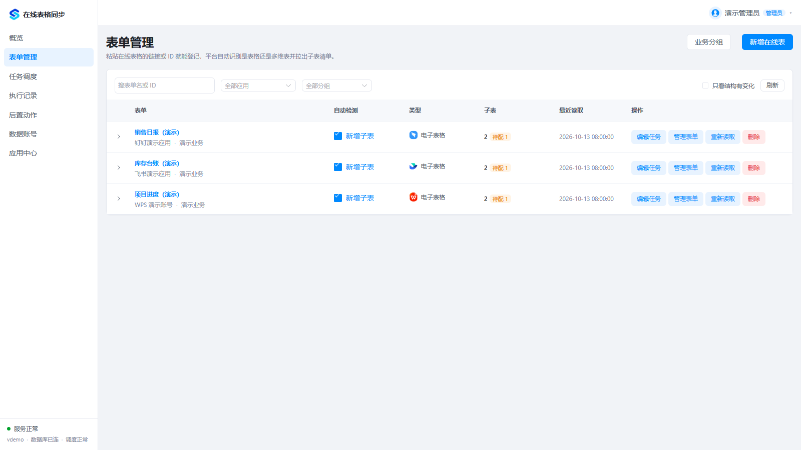
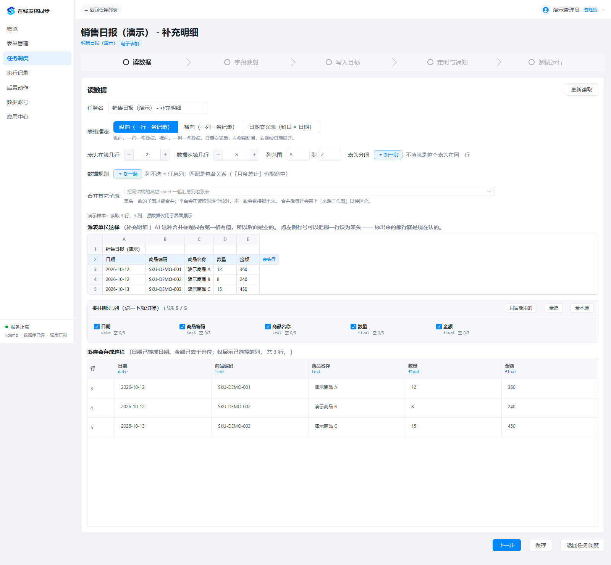
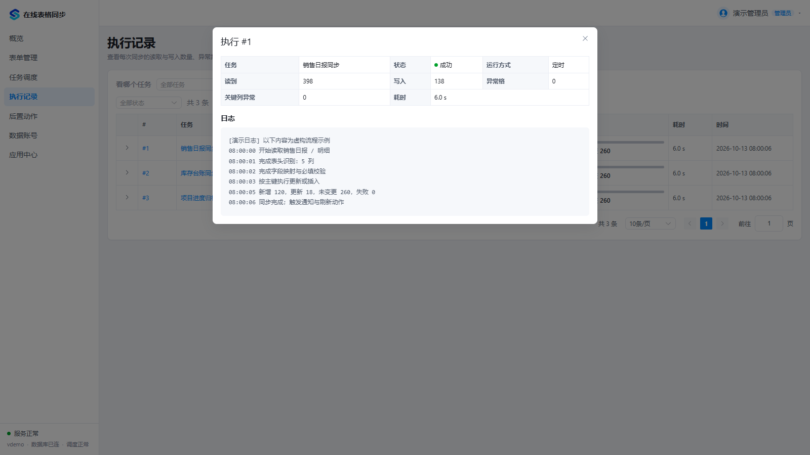
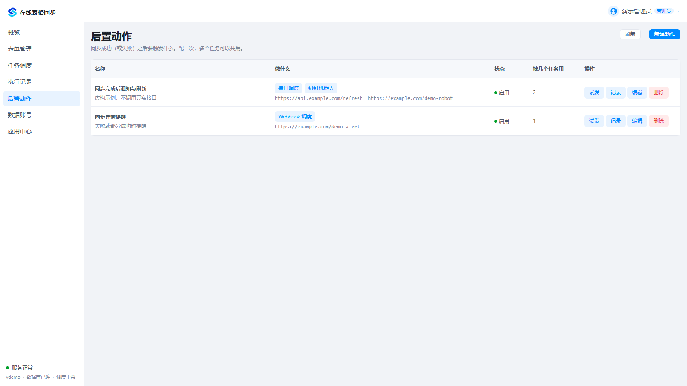

# docsync · 文档同步中心

将钉钉、飞书和 WPS 在线表格同步到 MySQL / SQL Server，支持字段映射、数据清洗、定时任务和下游通知。完整前后端源码采用 [MIT](LICENSE) 许可。

## 项目介绍

docsync 是一个可自托管的在线表格同步工具：团队继续在钉钉、飞书或 WPS 中维护表格，在网页里配置读取范围、字段映射和写入规则，让数据进入自己的 MySQL / SQL Server，供报表、数据分析和业务系统使用。

适合销售日报、库存台账、费用明细、项目进度等表格入库场景。应用配置、文档、任务和执行记录集中管理，支持在正式写入前先试跑检查结果。

- **网页配置**：管理平台应用、表单、子表、数据库连接和同步任务。
- **自主部署**：Docker 一份 Compose 文件即可启动，也支持 Linux 前后端手动部署。
- **完整源码**：Vue 3 + TypeScript + Element Plus 前端，FastAPI + SQLAlchemy 后端，MIT 许可。

## 功能一览

| 功能 | 已实现的能力 |
| --- | --- |
| 在线表格接入 | 钉钉电子表格与 AI 表格（多维表）、飞书电子表格与多维表、WPS 个人文档 |
| 文档管理 | 文档登记、分组、子表选择、字段变更检查 |
| 读取与预览 | 表头与数据起始位置配置、合并表头、日期矩阵、多子表合并、样本预览 |
| 字段映射 | 源字段对应目标字段，配置类型转换、默认值和必填校验 |
| 数据清洗 | 值替换、行过滤、多值拆分、异常原始值保留 |
| 数据库写入 | MySQL / SQL Server；追加、按键更新或插入、分区替换、全量替换 |
| 执行控制 | 手动试跑、正式执行、定时调度、破坏性写入保护 |
| 结果追踪 | 执行历史、日志、读取和写入行数、新增／更新／未变更／失败统计 |
| 后置动作 | Webhook、HTTP API 请求、钉钉通知 |
| 用户与凭据 | 管理员和只读角色、凭据加密、随机初始管理员密码 |

钉钉与飞书通过官方 API 接入，需要平台应用权限及文档授权；WPS 个人文档通过 Chromium 授权及 XLSX 下载读取，受第三方页面和下载行为影响。**Google Sheets 与 WPS 开发者 API 暂未实现**。

## 界面预览

以下图片由项目实际前端生成，使用虚构演示数据。统计数字、任务和数据库连接仅用于展示界面，不代表真实业务数据或第三方同步验证。

### 运行概览

集中查看任务规模、近期执行统计和下一次自动运行时间。

[](https://raw.githubusercontent.com/xiaoer2021/docsync/main/docs/images/overview.png)

### 任务调度

查看源表、目标表、定时规则、写入策略与上次执行结果。

[](https://raw.githubusercontent.com/xiaoer2021/docsync/main/docs/images/tasks.png)

### 执行记录

按任务查看同步历史，区分读取、写入、未变更与失败行数。

[](https://raw.githubusercontent.com/xiaoer2021/docsync/main/docs/images/runs.png)

### 数据库连接

统一管理 MySQL / SQL Server 目标连接，配置前可测试连接。

[](https://raw.githubusercontent.com/xiaoer2021/docsync/main/docs/images/datasources.png)

### 应用中心与表单管理

接入平台应用、登记在线表格并查看子表，从子表开始配置同步。完整操作见 [图文使用指南](docs/USAGE.md)。

[](https://raw.githubusercontent.com/xiaoer2021/docsync/main/docs/images/apps.png)

[](https://raw.githubusercontent.com/xiaoer2021/docsync/main/docs/images/docs.png)

### 读取预览与配置

核对表头、数据起始行、列范围和样本，配置清洗规则、选列、字段映射、写入目标及定时通知。

[](https://raw.githubusercontent.com/xiaoer2021/docsync/main/docs/images/read-data.png)

### 日志详情与后置动作

打开单次执行查看日志和数据质量，配置同步后的接口请求与通知。

[](https://raw.githubusercontent.com/xiaoer2021/docsync/main/docs/images/run-log.png)

[](https://raw.githubusercontent.com/xiaoer2021/docsync/main/docs/images/actions.png)

[查看完整操作截图：添加表单 → 子表 → 读数据 → 清洗规则 → 字段映射 → 写入目标 → 定时通知 → 测试运行](docs/USAGE.md)

## 从安装到第一次同步

1. 按下方 Docker 步骤启动，或阅读 [Linux 手动部署说明](DEPLOYMENT.md)。
2. 登录后修改管理员密码，在「应用管理」添加平台应用或完成 WPS 授权。
3. 在「数据源」添加目标 MySQL / SQL Server，并测试连接。
4. 在「表单管理」登记文档，选择要同步的子表。
5. 创建同步任务，预览源数据，配置字段映射、清洗规则和写入策略。
6. 先试跑并检查结果，再正式同步；按需要启用定时任务和后置动作。
7. 在「执行记录」核对写入结果和异常信息。

注意：执行成功不等于每个单元格都符合业务要求。普通异常值可能保留原始内容而不使整次执行失败；关键日期、金额、标识字段应配置校验。日期矩阵中的公式错误目前可能按零处理，使用前应核对源表。

## Linux 服务器快速部署（推荐）

服务器只需要 **Docker Engine 和 Compose v2**。不需要安装 Python、Node.js、MySQL，也不需要准备 `.env` 或手动生成密钥。尚未安装 Docker 时，按 [Docker 官方 Linux 安装说明](https://docs.docker.com/engine/install/)安装，使用 `docker compose version` 验证。

### 方式一：下载一份 Compose 文件

在服务器的新目录执行：

```bash
mkdir -p ~/docsync
cd ~/docsync
curl -fsSL https://raw.githubusercontent.com/xiaoer2021/docsync/main/docker-compose.yml -o docker-compose.yml
docker compose up -d --build --wait --wait-timeout 300
docker compose exec api cat /app/data/initial-admin-password
```

访问 `http://服务器IP:8090`，账号为 `admin`，密码为最后一条命令显示的随机初始密码。登录后在用户菜单修改口令。密码不会输出到启动日志；修改后，初始密码文件不再代表当前口令。

首次启动会由 Docker 从 GitHub 获取项目并在容器内安装依赖、构建前后端，耗时取决于网络和服务器性能。服务器需能访问 GitHub、Docker Hub、Debian 包源、PyPI 及 npm。已有服务占用 8090 时，修改下面端口映射的左侧数字。

### 方式二：直接复制完整 Compose 内容

将以下内容保存到服务器空目录的 `docker-compose.yml`，执行上面的启动及密码查看命令即可：

```yaml
name: docsync
services:
  api:
    image: docsync-api:local
    build:
      context: https://github.com/xiaoer2021/docsync.git#${DOCSYNC_REF:-main}:backend
    restart: unless-stopped
    init: true
    environment:
      DOCSYNC_ENV: prod
      DOCSYNC_AUTO_SETUP: 'true'
      DOCSYNC_DATA_DIR: /app/data
      DOCSYNC_META_DB_URL: sqlite+aiosqlite:////app/data/docsync.db
      DOCSYNC_WORKER_MAX_CONCURRENCY: '2'
    volumes:
      - docsync-data:/app/data
  web:
    image: docsync-web:local
    build:
      context: https://github.com/xiaoer2021/docsync.git#${DOCSYNC_REF:-main}:frontend
    restart: unless-stopped
    depends_on:
      api:
        condition: service_healthy
    ports:
      - '8090:80'
volumes:
  docsync-data:
```

默认使用 SQLite 保存系统配置、账号与任务，业务目标库仍在网页中配置。后端、浏览器登录档案、密钥和元数据库统一持久化到 `docsync_docsync-data` 卷。重启或重建容器保留这些数据；不要执行 `docker compose down -v`。

### 方式三：先拉取完整 GitHub 项目再部署

适合希望保留源码或后续修改的用户，服务器需另外有 Git：

```bash
git clone https://github.com/xiaoer2021/docsync.git
cd docsync
docker compose up -d --build --wait --wait-timeout 300
docker compose exec api cat /app/data/initial-admin-password
```

此 Compose 使用 GitHub 构建上下文，本地文件修改不会自动进入镜像。要部署自己的代码、使用 MySQL 元数据库或进行手动部署，请看 [Linux 部署与维护](DEPLOYMENT.md)。

## Linux 手动部署前后端

不使用 Docker 时，从 GitHub 拉取项目后安装后端运行环境并构建前端：

```bash
git clone https://github.com/xiaoer2021/docsync.git
cd docsync
```

完整步骤见 [Linux 手动部署](DEPLOYMENT.md#linux-手动部署前后端)，包含 Python 虚拟环境、初始化管理员、systemd 常驻服务、Node.js 构建、Nginx 静态页面和反向代理。仓库提供可直接安装的配置文件：

- [后端 systemd 服务](deploy/linux/docsync.service)
- [前端 Nginx 配置](deploy/linux/nginx.conf)

## 常用操作

```bash
docker compose ps
docker compose logs --tail 100 api
docker compose exec api python -m app.cli check
docker compose restart
```

升级前备份数据卷；保留原 Compose 项目名及卷名。默认 `main` 跟随最新代码，稳定部署可固定提交：

```bash
DOCSYNC_REF=完整提交SHA docker compose up -d --build --wait --wait-timeout 300
```

首次使用：配置平台应用和权限 → 添加目标数据库 → 登记文档 → 创建任务 → 试跑核对 → 正式执行 → 配置调度。

## 支持与边界

| 项目 | 说明 |
|---|---|
| 钉钉、飞书电子表格及多维表格 | 开放平台 API，需要应用授权及文档权限 |
| WPS 个人版 | Chromium 授权后下载 xlsx，需导出权限，依赖平台页面与下载行为 |
| Google / WPS 官方开发者 API | 尚未实现，不作为可用连接器 |
| 目标数据库 | MySQL、SQL Server |
| 元数据库 | 快速部署默认 SQLite，另提供 MySQL 方案 |

关键列转换失败会停止写入；普通异常值可留空并保留原文，执行仍可能显示成功。日期交叉表的公式错误按当前规则取 0，需核对业务口径。试跑成功不等于正式写库成功。

内嵌调度只运行一个 API 进程，不能直接增加 workers 或多个副本。公网入口应配置 HTTPS；安全说明见 [SECURITY.md](SECURITY.md)，第三方许可见 [THIRD_PARTY_NOTICES.md](THIRD_PARTY_NOTICES.md)。开发说明见 [CONTRIBUTING.md](CONTRIBUTING.md)。
