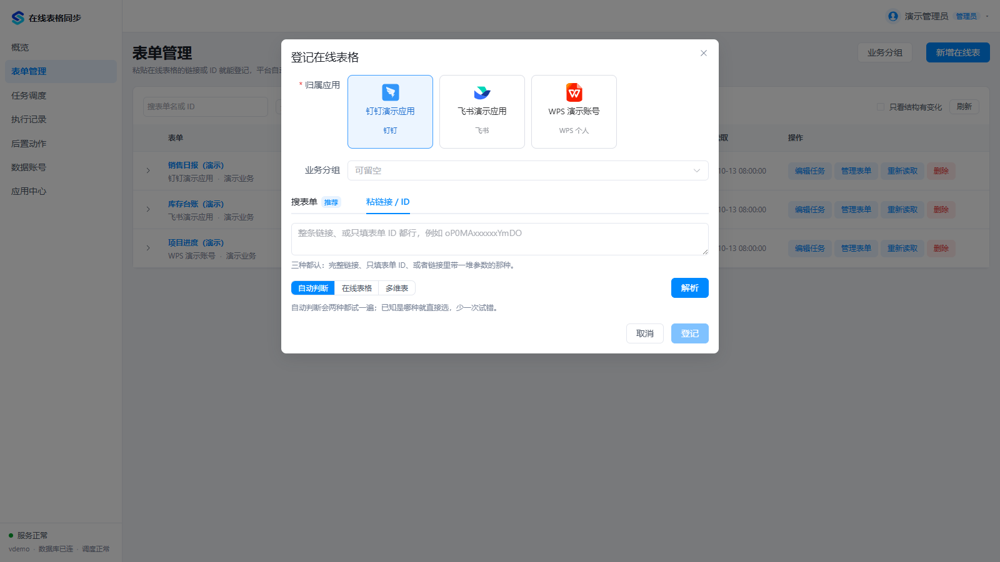
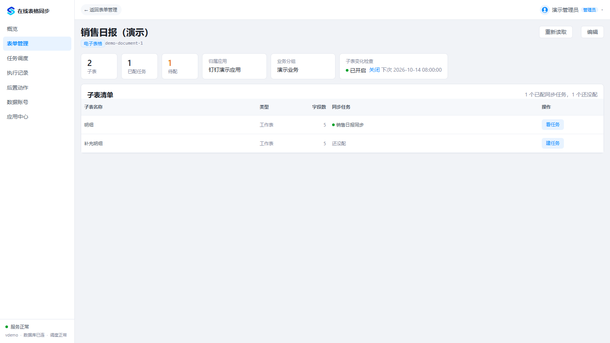
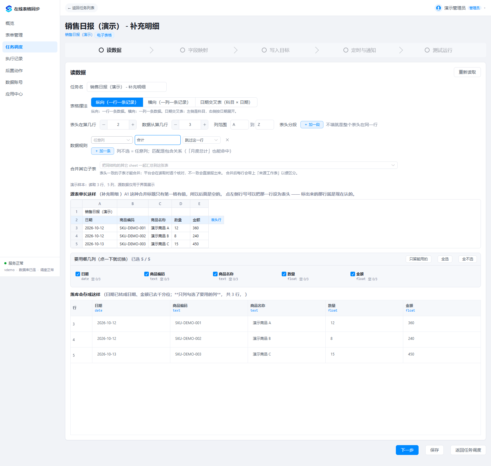
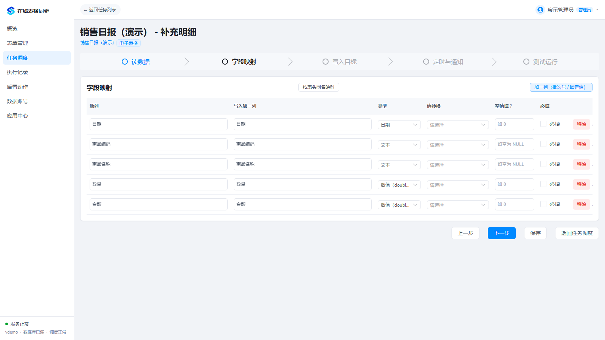
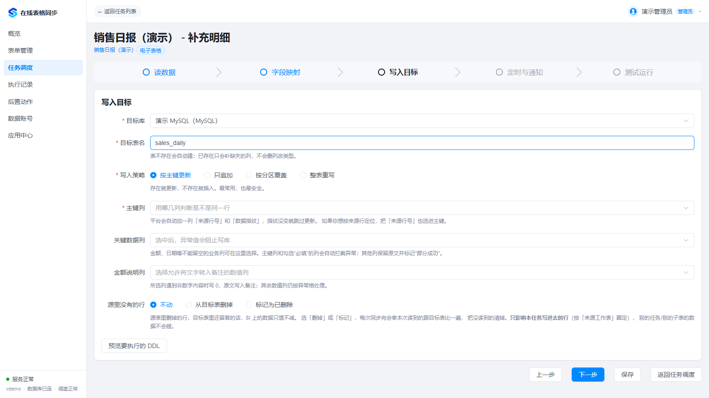
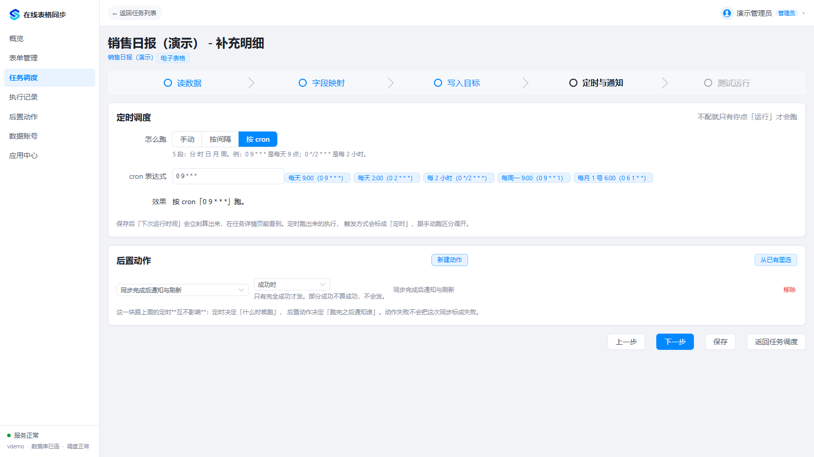
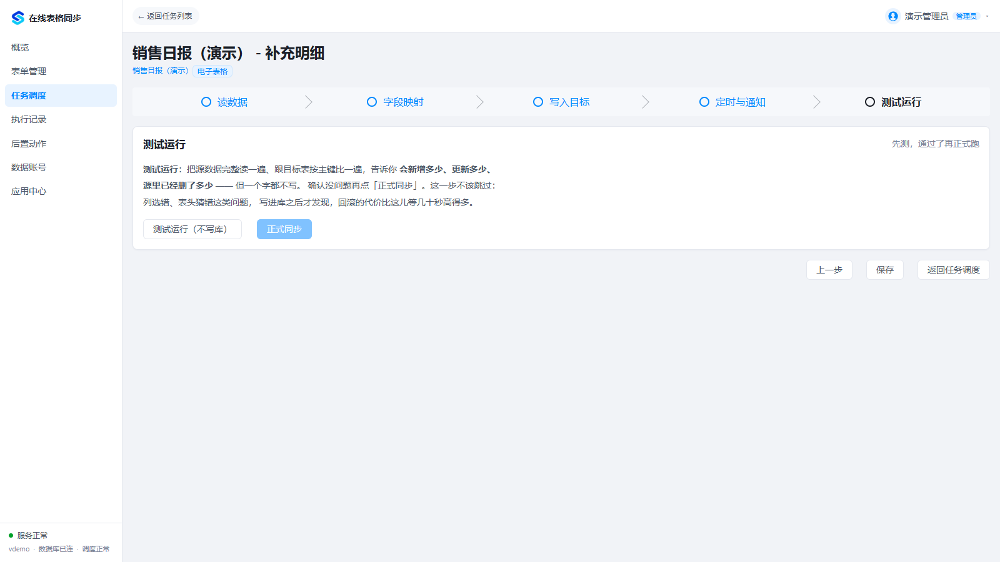

# 图文使用指南

本指南展示从接入应用、登记表单到配置同步和查看日志的操作。截图来自实际前端，使用虚构演示数据及模拟 API 响应；演示连接、统计和日志不是实际第三方同步结果。安装方式见 [部署说明](../DEPLOYMENT.md)。

## 1. 应用中心：准备读取权限

在「应用中心」点击「接入应用」。钉钉与飞书填写平台应用凭据，并按向导申请权限、设置操作人和验证；文档本身也必须授权给应用或操作人。WPS 个人文档通过账号授权读取。一个应用可以供多份表单复用。

Google Sheets 与 WPS 开发者 API 尚未实现；界面存在平台入口不代表对应连接器可用。

## 2. 表单管理：添加在线表

点击「新增在线表」，先选择归属应用和可选业务分组。钉钉／飞书可以按名称搜索（需要文件搜索权限），也可以切到「粘链接 / ID」；WPS 使用金山分享链接。

粘贴文档链接或 ID，点击「解析」，核对识别出的类型和子表后再「登记」。解析失败时先检查应用权限、操作人和文档授权。

添加后，在表单列表中查看最近读取时间、子表数量和待配置数量；可以重新读取、编辑任务、管理表单或按分组筛选。

## 3. 选择子表并建立任务

进入表单详情，查看子表清单。「重新读取」用于更新子表信息；子表变化检查用于发现新增或变更。未配置的子表点击「建任务」，已配置的子表点击「看任务」。也可以在表单列表展开子表后操作。

## 4. 读数据：确认结构与范围

进入任务向导的「读数据」，页面会加载样本预览。先确认源表结构，再检查下面的入库预览。

| 操作 | 用途 |
| --- | --- |
| 表格摆法 | 纵向是一行一条记录；横向是一列一条记录；日期交叉表适用于科目 × 日期 |
| 表头与数据起始位置 | 示例第 1 行是标题，第 2 行是表头，第 3 行开始才是明细 |
| 列范围 | 通过 A、B、C 等列标限定读取范围 |
| 表头分段 | 表头分布在不同的行时，按列范围添加不同表头段 |
| 源表行号 | 点击左侧行号设置表头，重新检查预览 |
| 合并其它子表 | 选择相同结构的子表一起同步；表头不一致会报错 |
| 选列 | 勾选需要入库的列，支持全选、全不选和只留能用的列 |
| 样本与入库预览 | 对照原始表格、类型判断与转换后的值，避免把标题和合计当成明细 |
| 重新读取 | 修改范围或规则后再次核对样本 |

样本预览用于配置判断，不能替代全量试跑。

### 配置跳过或替换规则

在「数据规则」点击「＋ 加一条」，指定匹配列、包含的内容，以及「跳过这一行」或「替换成」。列不选时匹配任意列。示例将包含「合计」的行跳过，避免汇总数和明细重复入库；实际规则应根据自己的表格设置。

## 5. 字段映射：确定入库字段

在「字段映射」为每个源列设置目标字段名、类型、值转换、空值默认值和必填要求。可按表头同名映射，也可增加批次号或固定值列。

日期按日期解析，金额可去掉千分位或货币符号，数量可去除单位。不要仅凭自动推断就正式同步，先核对真实样本。

## 6. 写入目标：选择库、表和策略

目标连接先在「数据账号」添加并测试。在任务中选择目标库、目标表名和写入策略。

- 按主键更新：存在则更新，不存在则插入；选择能稳定标识一条业务记录的键。
- 只追加：每次新增，适合流水；重复运行可能产生重复记录。
- 按分区覆盖：替换指定分区的数据，需要正确设置分区字段。
- 整表重写：替换目标表数据，正式执行前必须核对范围和保护条件。

关键数据列异常可阻止写入；「源里没有的行」可以保持、删除或标记删除，应按业务需要选择。界面截图中的目标表名仅是示例。

## 7. 定时与后置动作

任务可手动执行、按间隔执行或按五段 cron 执行。按间隔与每天固定时刻不同；固定时刻建议使用 cron，并核对部署时区。

在「后置动作」集中配置 Webhook、接口请求或钉钉机器人通知。动作可供多个任务复用，点击「记录」检查动作是否执行成功；「试发」会实际发送，请使用自己的测试地址。

任务向导中点击「从已有里选」，选择动作与触发条件：成功、部分成功、失败、没完全成功或每次都做。成功时不会包含部分成功；需要异常提醒时，应明确选择对应条件。

## 8. 先测试，再正式同步

保存配置后，在「测试运行」先点击「测试运行（不写库）」，检查全量读取、字段质量和预计写入结果，确认后再「正式同步」。配置发生变化后应重新测试。

## 9. 执行记录与日志

在「执行记录」按任务或状态筛选。点击记录打开详情，查看读取、写入、异常格、关键列异常和日志；也可以展开行查看日志正文及异常行信息。

同步本身成功和后置动作成功需分别核对。普通异常单元格可能保留原始值而不导致整次失败；关键日期、金额和标识列应显式设置校验。日期矩阵公式错误目前可能按零处理，使用前需核对源表。

